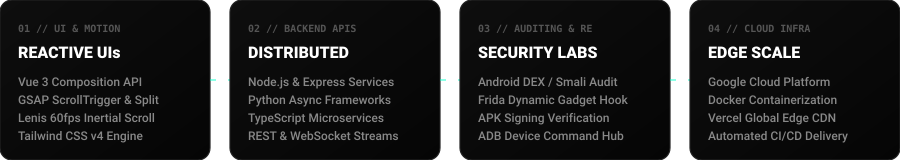

 

  
  
  

---

### // OVERVIEW

Official interactive developer platform and engineering portfolio of **Abin Binoy (4bin / BROHUHA)** — Full-Stack Software Engineer & Cloud Architect based in Kerala, India.

Engineered with modern reactive single-page architecture, hardware-accelerated 60fps timeline choreography, custom 3D CSS perspective physics, and high-performance serverless cloud edge delivery.

* **Live Platform:** [https://4bin.vercel.app](https://4bin.vercel.app)
* **Direct Route Showcase:**
  * **Works & Systems:** [4bin.vercel.app/works](https://4bin.vercel.app/works)
  * **Interactive Resume:** [4bin.vercel.app/resume](https://4bin.vercel.app/resume)
  * **Engineering Hub:** [4bin.vercel.app/tools](https://4bin.vercel.app/tools)
  * **Direct Contact:** [4bin.vercel.app/contact](https://4bin.vercel.app/contact)

---

### // SYSTEM ARCHITECTURE & CAPABILITIES

  

 

* **Frontend Engine:** Vue 3 (Composition API, `<script setup>`), Nuxt 3 SPA framework, Vite 6 bundler.
* **Choreography & Motion:** GSAP (ScrollTrigger, SplitText, Observer), Lenis smooth inertial scrolling engine.
* **Design System & Styling:** Tailwind CSS v4 utility architecture, raw brush typography (*Grindy Brush*), Swiss international grid, and responsive 3D card jewel case physics (`perspective-[1000px]`, `transform-3d`).
* **Cloud & Edge Infrastructure:** Vercel Global Edge Network, Google Cloud Platform (Cloud Run, Pub/Sub), Docker containerization, sub-120ms asset caching.

---

### // FEATURED LIVE SYSTEMS & PRODUCTION DEPLOYMENTS

| System | Classification | Core Stack | Live Endpoint |
| :--- | :--- | :--- | :--- |
| **Cabix** | Lift Technician &amp; Maintenance Web App | React • Next.js • Node.js • TailwindCSS | [cabix.vercel.app ↗](https://cabix.vercel.app) |
| **Iceberg Concept** | Free Developer &amp; Designer Resource Directory | Next.js • React • TailwindCSS • Web API | [tipoficeberg.vercel.app ↗](https://tipoficeberg.vercel.app) |
| **ALLQR** | Universal Dynamic QR Generator &amp; Scanner | Vue 3 • Nuxt • Canvas API • TailwindCSS | [allqr.vercel.app ↗](https://allqr.vercel.app) |
| **YZ Music Web** | High-Fidelity Audiophile Web Audio Player | Web Audio API • Canvas Visualizer • JS | [yzmusic-promode.vercel.app ↗](https://yzmusic-promode.vercel.app) |
| **APKCook** | Android App Security &amp; Dynamic Tooling Platform | .NET 8 • Avalonia UI • TypeScript • Frida | [apkcook.vercel.app ↗](https://apkcook.vercel.app) |
| **BT-Scanner** | AI Brain Tumor MRI Diagnostic Suite | Python • TensorFlow • OpenCV • CNN | [github.com/BROHUHA/BT-Scanner ↗](https://github.com/BROHUHA/BT-Scanner) |

---

### // VERIFIED CHANNELS & COORDINATES

* **Platform:** [https://4bin.vercel.app](https://4bin.vercel.app)
* **GitHub:** [github.com/BROHUHA](https://github.com/BROHUHA)
* **LinkedIn:** [linkedin.com/in/abinn-binoyy](https://www.linkedin.com/in/abinn-binoyy/)
* **Email:** [abinbinoy2000@gmail.com](mailto:abinbinoy2000@gmail.com)
* **WhatsApp:** [+91 8075747414](https://wa.me/918075747414)
* **Instagram:** [@abinn.binoyy](https://www.instagram.com/abinn.binoyy/)
* **Location:** Kerala, India

---

### // LICENSE

This project, its architectural designs, visual assets, and platform contents are authored by **Abin Binoy** and licensed under the **[Creative Commons Attribution-NonCommercial-NoDerivatives 4.0 International License (CC BY-NC-ND 4.0)](https://creativecommons.org/licenses/by-nc-nd/4.0/)**.

* **Attribution:** Credit must be given to **Abin Binoy (4bin / BROHUHA)** with link to [4bin.vercel.app](https://4bin.vercel.app).
* **NonCommercial:** The material may not be used for commercial purposes.
* **NoDerivatives:** If you remix, transform, or build upon the material, you may not distribute the modified material.

For permissions beyond the scope of this license, direct inquiries to `abinbinoy2000@gmail.com`.

---

  &copy; 2024–2026 Abin Binoy (4bin / BROHUHA). Licensed under <a href="https://creativecommons.org/licenses/by-nc-nd/4.0/">CC BY-NC-ND 4.0</a>.

